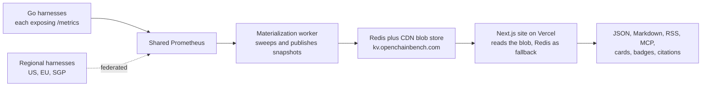

# OpenChainBench

**OpenChainBench measures crypto infrastructure the same way for every provider, publishes the number, and ships the code that produced it.** RPC endpoints, data APIs, bridges, perp DEXes, prediction markets, oracles, cross-chain messaging. Live at **[openchainbench.com](https://openchainbench.com)**.

[](https://openchainbench.com/benchmarks)
[](./LICENSE)
[](https://creativecommons.org/licenses/by/4.0/)
[](https://pypi.org/project/openchainbench/)
[](https://openchainbench.com/mcp)
[](https://doi.org/10.5281/zenodo.20800311)

Every benchmark ships with the harness that produces its data. Harness code is MIT, the dataset is CC-BY-4.0, and pull requests are open to anyone including the providers being measured.

## What this is

- A public registry of benchmarks, one YAML spec per benchmark, each naming its metric, its methodology and the exact PromQL behind every published figure.
- A set of self-contained Go harnesses that probe providers on a schedule and expose Prometheus metrics. One shared Prometheus scrapes them, one worker materializes snapshots, the site reads those snapshots.
- A citable data surface. Every figure carries an `asOf` timestamp, a source URL, and a licence, in JSON, Markdown, RSS, BibTeX and an MCP server.

## What this is not

- Not a token, a fund, or an RPC vendor. We do not sell placement in a ranking, and a provider cannot change a conclusion or a figure. See Funding and links below for what we do earn from.
- Not a preview service. A provider can be shown the facts behind a report before it is published, and the staging site is public, so numbers are visible before a release. What a provider cannot do is alter them.
- Not a single-vendor view. Providers that cannot be measured under identical conditions are split into separate benchmarks, or filtered to the same scope, and the spec says which.

## Get the data in 30 seconds

```bash
pip install openchainbench
```

```python
from openchainbench import OpenChainBench

with OpenChainBench() as ocb:
    for b in ocb.list_benchmarks()[:5]:
        print(b.slug, b.leader)

    head_lag = ocb.get_benchmark("aggregator-head-lag")
    print(head_lag.headline)
```

No key and no account. Read endpoints allow 60 requests a minute per IP, and the AI crawlers named in `robots.txt` are exempt. The same data over plain HTTP:

```bash
# every benchmark with its current value, leader and citation
curl https://openchainbench.com/api/citable

# one benchmark: rankings, 24h sparkline, methodology, paste-ready quote
curl https://openchainbench.com/api/stat/aggregator-head-lag

# a benchmark as Markdown instead of HTML, at the same URL
curl -H "Accept: text/markdown" https://openchainbench.com/benchmarks/bridge-fee
```

For an agent, point an MCP client at the hosted server:

```json
{ "mcpServers": { "openchainbench": { "url": "https://openchainbench.com/api/mcp/mcp" } } }
```

It exposes `list_benchmarks`, `get_benchmark`, `search_benchmarks`, `compare_providers`, `recommend_provider` and `list_answers`, plus the `openchainbench://benchmark/{slug}` resource. Install notes are at [`/mcp`](https://openchainbench.com/mcp).

## One benchmark, end to end

A benchmark is a spec, a harness, and the surfaces generated from them. Take `aggregator-head-lag`, which measures how long a data API takes to emit a swap that is already on chain.

**The spec** ([`benchmarks/aggregator-head-lag.yml`](./benchmarks/aggregator-head-lag.yml)) declares the metric, the unit, whether higher is better, the written methodology, and one PromQL query per provider per percentile. Nothing on the page is typed by hand.

**The harness** ([`harnesses/aggregator-head-lag/`](./harnesses/aggregator-head-lag)) subscribes to chain events and to each provider's feed, races them per transaction, and exposes the result at `/metrics`.

**The published shape**, from `GET /api/stat/aggregator-head-lag`:

```jsonc
{
  "slug": "aggregator-head-lag",
  "metric": "Head lag",
  "unit": "s",
  "higherIsBetter": false,
  "value": 0.240038,                  // example reading, 2026-10-25
  "leader":   { "name": "Codex", "slug": "codex", "value": 0.240038 },
  // ms holds the raw series value in the benchmark's stored unit, which is
  // not always milliseconds: on a percent benchmark it holds a percent.
  "rankings": [ { "name": "Codex", "ms": { "p50": 240.038, "p90": 399.49 } } ],
  "sparkline": [ /* 73 points, last 24h */ ],
  "sampleSize": 184980,
  "measured": 6,
  "ranked": 6,
  "asOf": "2026-10-25T19:26:11.573Z",
  "freshness": { "ageHours": 0.2, "stale": false },
  "headline": "...",                  // one sentence, ready to quote
  "methodology": [ /* the written rules, same text as the page */ ],
  "source": "https://github.com/ChainBench/OpenChainBench/tree/main/harnesses/aggregator-head-lag",
  "license": "CC-BY-4.0"
}
```

`headline` is generated from the current reading, so it is correct whenever you fetch it and stale the moment it is pasted into a file. Quote it with its `asOf`. For a formal citation use `/api/cite/<slug>/bib`.

## By the numbers

<!-- stats:start generated by `pnpm readme:sync`, do not edit by hand -->
| In this repository | Count |
|---|---|
| Benchmark spec files (`benchmarks/*.yml`) | 253 |
| Harness directories (`harnesses/*/`, every one a Go module) | 70 |
| Answer pages (`answers/*.yml`) | 49 |
| Alternatives pages (`alternatives/*.yml`) | 21 |
| Distinct categories (`category:` values across the specs) | 9 |
| Held on staging until a release condition is met (`DEV_ONLY_BENCH_SLUGS`) | 5 |
| Retired, answering `410 Gone` or redirecting to a successor (`REMOVED_BENCH_SLUGS`) | 25 |

253 specs, minus 5 held on staging, minus 2 retired benches that keep their spec, leaves 246 benchmarks that this commit publishes. Counts derived from the repository at 2026-10-25.
<!-- stats:end -->

The badge at the top reads the live count from `/api/citable`, which is what production serves. The table is derived from the commit you are reading. The two agree once a change has been released, and differ while a benchmark is merged and waiting, so comparing them tells you something instead of requiring you to trust either.

## Machine-readable surfaces

Every benchmark is CC-BY-4.0 and reachable without a key.

| Endpoint | What it returns |
|---|---|
| [`/api/citable`](https://openchainbench.com/api/citable) | Every benchmark with its current value, leader, headline sentence, citation and `asOf`. Start here. |
| [`/api/stat/<slug>`](https://openchainbench.com/api/stat/aggregator-head-lag) | One benchmark: rankings, 24h sparkline, methodology, quote, source, freshness. |
| [`/api/series/<slug>`](https://openchainbench.com/api/series/aggregator-head-lag?range=24h) | Per-provider time series. `?range=24h`. |
| [`/api/compare/<a>/<b>`](https://openchainbench.com/api/compare/codex/mobula) | Two providers across every benchmark they share. |
| `/api/cite/<slug>/<format>` | Citation as `bib`, `ris`, `apa` or `txt`, with the matching content type. |
| [`/api/openapi.json`](https://openchainbench.com/api/openapi.json) | OpenAPI 3.1 schema covering 11 of the read endpoints. |
| [`/api/mcp/mcp`](https://openchainbench.com/mcp) | MCP server over streamable HTTP. Six tools and one resource template. |
| [`/api/llm-context`](https://openchainbench.com/api/llm-context) | Every benchmark with rankings and methodology as one Markdown document. |
| [`/llms.txt`](https://openchainbench.com/llms.txt) · [`/llms-full.txt`](https://openchainbench.com/llms-full.txt) | Index and full context per the [llmstxt.org](https://llmstxt.org) convention. `llms-full.txt` and `/api/llm-context` serve the same document. |
| `Accept: text/markdown` | Returns Markdown instead of HTML at the page's own URL, on `/benchmarks/<slug>`, `/products/<slug>`, `/perps`, `/rwa` and `/capital`. Browsers are unaffected because they ask for HTML first. |
| [`/api/freshness`](https://openchainbench.com/api/freshness) | `{slug: asOf}` in epoch milliseconds for every benchmark, plus the server's `now`. Cached 30 s. |
| [`/api/og/<slug>`](https://openchainbench.com/api/og/aggregator-head-lag) | The 1200x630 card with the current value, leader and sparkline, at a stable URL. |
| [`/benchmarks/<slug>/share-card`](https://openchainbench.com/benchmarks/aggregator-head-lag/share-card) | Export card in five templates (`ranking`, `snapshot`, `headline`, `compare`, `leaderboard`), with `?theme=dark`. |
| [`/api/badge/<bench>/<provider>`](https://openchainbench.com/api/badge/aggregator-head-lag/mobula) | Embeddable SVG with that provider's rank and figure. Add `/snippet` for paste-ready Markdown. |
| [`/rss.xml`](https://openchainbench.com/rss.xml) · [`/feed.json`](https://openchainbench.com/feed.json) | RSS 2.0 and JSON Feed 1.1, one entry per live benchmark. |
| [`/sitemap.xml`](https://openchainbench.com/sitemap.xml) · [`/robots.txt`](https://openchainbench.com/robots.txt) | Every URL we publish. More than thirty AI and answer-engine crawlers are named and allowed explicitly. |
| [`/contribute/ai-brief.md`](https://openchainbench.com/contribute/ai-brief.md) | A brief written for coding agents contributing a benchmark. |

Each benchmark page also carries `Dataset`, `StatisticalReport`, `Observation`, `TechArticle`, `FAQPage`, `DataDownload` and `BreadcrumbList` JSON-LD.

Two mirrors are published outside this repo: a [Hugging Face dataset](https://huggingface.co/datasets/OpenChainBench/benchmarks) with a daily parquet snapshot, and a Zenodo record under [DOI 10.5281/zenodo.20800311](https://doi.org/10.5281/zenodo.20800311).

## Site surfaces

| Route family | What lives there |
|---|---|
| [`/benchmarks`](https://openchainbench.com/benchmarks), `/benchmarks/<slug>`, `/benchmarks/<slug>/<chain>` | Catalogue, then one leaderboard per benchmark with chart, ledger, chain and region filters, share cards and FAQ. Chain-scoped views carry their own explainer. |
| [`/products/<slug>`](https://openchainbench.com/products/mobula) | One page per product: every benchmark it appears in, first-place counts, related products, and a view per category it belongs to. |
| [`/chains/<slug>`](https://openchainbench.com/chains/ethereum) | Per-chain hub: native price, TVL history, and every benchmark touching that chain grouped by category. |
| [`/compare/<a>-vs-<b>`](https://openchainbench.com/compare/codex-vs-mobula) | Head to head across shared benchmarks. Alphabetical order is canonical and enforced with a redirect. |
| [`/answers/<slug>`](https://openchainbench.com/answers/which-crypto-data-api-covers-the-most-blockchains) · [`/alternatives/<slug>`](https://openchainbench.com/alternatives/alchemy) | Question pages and "alternatives to X" pages, each backed by a live benchmark rather than by prose. |
| [`/rpc`](https://openchainbench.com/rpc) · [`/perps`](https://openchainbench.com/perps) · [`/prediction-markets`](https://openchainbench.com/prediction-markets) · [`/hyperliquid`](https://openchainbench.com/hyperliquid) · [`/capital`](https://openchainbench.com/capital) | Vertical hubs aggregating several benchmarks per topic. |
| [`/methodology`](https://openchainbench.com/methodology) · [`/contribute`](https://openchainbench.com/contribute) · [`/mcp`](https://openchainbench.com/mcp) · [`/press`](https://openchainbench.com/press) · [`/badges`](https://openchainbench.com/badges) · [`/about`](https://openchainbench.com/about) | How it works, how to contribute, how to cite and embed. |

## How it works



- **Harnesses** run as containers on one VPS in Paris. A few that must measure from more than one place run on Railway and federate into the same Prometheus, because a latency number is meaningless without saying where it was measured from.
- **The worker** sweeps Prometheus on a timer and publishes atomic snapshots to Redis and to CDN blobs at `kv.openchainbench.com/aggregate/...`. The site reads the blob first, falls back to Redis, and falls back again to the last known good snapshot rather than rendering an empty page.
- **The site** is Next.js 16 on Vercel. `main` deploys to production automatically, with a warm-up pass, a sitemap indexability smoke test, an automatic rollback if that test fails, and an IndexNow ping once it passes. `dev` deploys to a staging preview.
- **Routing rules** are in [`src/middleware.ts`](./src/middleware.ts) and `next.config`: a retired benchmark answers `410 Gone` with a link to the catalogue, or redirects permanently when it has a successor, and a renamed one redirects permanently to its new slug, and `/compare/<b>-vs-<a>` redirects to the canonical alphabetical order so one comparison has one URL.
- **The live dashboard** reads a WebSocket relay at `wss://stream.openchainbench.com/ws`, which the maintainers run separately because it holds upstream API keys. The browser talks to it directly.

Depth, including a clone-and-run-it-yourself walkthrough, is in [`docs/architecture.md`](./docs/architecture.md).

## Repo layout

```
benchmarks/        one YAML spec per benchmark
harnesses/         one Go module per harness, each self-contained and Dockerized
answers/           Q&A specs backing /answers/<slug>
alternatives/      "alternatives to X" specs backing /alternatives/<slug>
packages/          python-client, published to PyPI as openchainbench
worker/            materialization worker: Prometheus to CDN and Redis snapshots
infrastructure/    shared Prometheus config
src/               the Next.js site, App Router, TypeScript, Tailwind, Zod
scripts/           spec validators, prebuild manifests, sitemap smoke test
docs/              architecture.md, methodology, walkthrough.md
public/            static assets served by the site
video/             the renderer behind the Export video button on every benchmark page
.github/           CI, production deploy, staging preview, dataset publishing
```

`data/` holds one generated build artifact. `crm/` and `outreach/` are internal tooling and not part of the published benchmark surface.

## Contributing

Long form in [CONTRIBUTING.md](./CONTRIBUTING.md), visual walkthrough at [`/contribute`](https://openchainbench.com/contribute), and a brief for coding agents at [`/contribute/ai-brief.md`](https://openchainbench.com/contribute/ai-brief.md).

1. Float the idea in [Discussions](https://github.com/ChainBench/OpenChainBench/discussions).
2. Open a `Propose a benchmark` issue with the metric and the methodology, before writing code.
3. Write the harness. Go is the convention, but anything that serves `/metrics` over HTTPS works.
4. Host it anywhere with a stable HTTPS URL. You keep your keys and your budget; maintainers never see them.
5. Open a PR against `dev` with the spec, a link to the harness, and the Prometheus scrape config.
6. Review it on the staging preview. It reaches production once data has landed and the page reads correctly.

Local checks before you open it:

```bash
pnpm install
pnpm dev              # http://localhost:3000
pnpm validate         # every spec against the Zod schema
pnpm check            # validate, typecheck, lint, test
```

## How we decide what to publish

- **Same metric, same conditions.** Where providers cannot be measured identically they are split apart or filtered to a common scope, and the benchmark says so rather than comparing them anyway.
- **Marketing does not shape a number.** The published methodology and the harness are the only inputs.
- **A benchmark earns its page.** New ones are held on staging until a written condition is met, usually a full measurement window and an audit round. The conditions are in [`src/lib/removed-benches.ts`](./src/lib/removed-benches.ts), one comment per benchmark, including the ones still waiting.
- **Retirement, not deletion.** A retired benchmark answers `410 Gone` and keeps its entry, or redirects to its successor where one exists, so an indexed URL decays honestly instead of disappearing.
- **No number without a timestamp.** Every JSON surface carries `asOf`, and `/api/freshness` returns the whole map as epoch milliseconds, so a reader can tell fresh from stale without asking us.
- **A draft never quotes a figure.** If too few providers report, the page says it is awaiting samples instead of crowning a leader on thin data.

## Funding and links

Some product pages link out to the provider they describe through a referral link, which can earn a commission on a signup. They are declared as `referralUrl` in [`src/data/provider-registry.ts`](./src/data/provider-registry.ts), ten of them today, and rendered with `rel="sponsored"` so a crawler sees what they are. The repository also declares an Optimism Retro Funding project in [`funding.json`](./funding.json).

A referral link is a display field on a product page and is not an input to anything measured. Every published figure comes from the PromQL in a benchmark's spec, evaluated against metrics a harness in this repository produced, so a link cannot move a rank and deleting every one of them would not change a value on the site.

## Cite this

```bibtex
@misc{openchainbench,
  author    = {OpenChainBench},
  title     = {OpenChainBench: live benchmarks for crypto infrastructure},
  year      = {2026},
  doi       = {10.5281/zenodo.20800311},
  url       = {https://openchainbench.com},
  note      = {Dataset licensed CC-BY-4.0}
}
```

For one benchmark, `GET /api/cite/<slug>/bib` returns the same shape for that page, and `ris`, `apa` and `txt` are also available. The DOI above always resolves to the latest version of the dataset record.

## Questions

**Is the data free to use?** Yes. The dataset is CC-BY-4.0, so quote it, chart it, or ship it in a product, with attribution to OpenChainBench and a link to the page you took it from. Harness code is MIT.

**Can I add my own product?** Yes, including if we already measure you. Providers open PRs here. What a PR cannot do is change a number without changing the method that produced it, and a method change applies to every provider in that benchmark at once.

**A figure about my product looks wrong. What now?** Open a [provider correction issue](https://github.com/ChainBench/OpenChainBench/issues/new?template=provider-correction.yml) with the page, the figure and what you measured instead. Every published value traces to a PromQL query in a spec and a harness in this repo, so a disagreement is usually resolvable by reading both.

**How current is a number?** Each benchmark carries its own `asOf`. `/api/freshness` returns the whole map in one request, and a page that has gone stale says so rather than showing an old figure as current.

**Why does a benchmark exist in this repo but not on the site?** Because it has not met its release condition yet. Those are listed with a reason in `src/lib/removed-benches.ts`, and the arithmetic in the numbers table above accounts for every one of them.

**Do you measure providers who do not want to be measured?** We measure endpoints any customer can reach under their published terms, free ones and paid ones, and the keyed benchmarks say which plan was used. A provider can ask for its methodology to be corrected and that is usually a good PR, but not for its result to be removed because the result is unflattering.

## Community and licence

[Discussions](https://github.com/ChainBench/OpenChainBench/discussions) · [@OpenChainBench](https://x.com/OpenChainBench) · [PyPI](https://pypi.org/project/openchainbench/) · [Hugging Face](https://huggingface.co/datasets/OpenChainBench/benchmarks) · [Zenodo](https://doi.org/10.5281/zenodo.20800311) · [Wikidata](https://www.wikidata.org/wiki/Q140756438)

Harness code and site code MIT. Dataset CC-BY-4.0, attribution required. See [LICENSE](./LICENSE).
